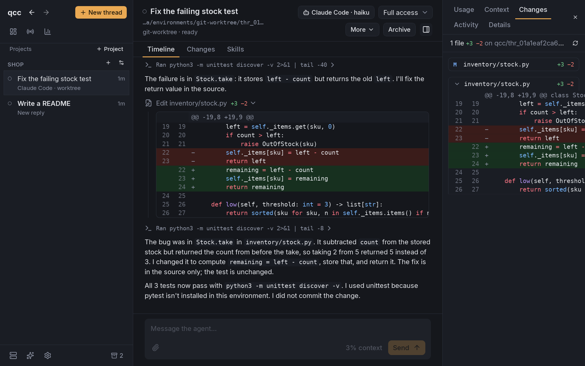

<div align="center">

# qcc

**A control center for coding agents.**
Run Claude Code, Codex and opencode side by side, watch every session in one place, and answer
whichever agent needs you.

**English** · [Русский](README.ru.md)

</div>



qcc has no agent loop of its own. The real agent CLIs do the work, and qcc runs their sessions as
*threads*: it keeps each thread's timeline in a journal, isolates threads in git worktrees, lets
agents start other agents, and is extended with WebAssembly plugins.

## Features

- **Real agents, one timeline.** Claude Code, Codex and opencode run through provider plugins that
  turn each agent's protocol into the same timeline: messages, commands with output, edits with
  diffs, tool and MCP calls, permission prompts and questions.
- **Many agents at once.** An overview of who needs you, who is working and who is done; a Live
  wall of running agents; metrics of tokens, turns and tools over time.
- **Answer from anywhere.** Approve a command or answer an agent's question from the thread, the
  overview card, the Live tile or the CLI.
- **Isolated work.** A thread can get its own git worktree on its own branch. Review its changes,
  comment on lines like in a code review, then apply or merge the work back into your checkout.
- **Orchestration.** Agents start agents through the `qcc` CLI. Children inherit the parent's
  project, model and permission mode and never run with more freedom than the parent; built-in
  `handoff` and `review` commands pass work between agents.
- **Switch mid-thread.** Change the model, effort, permission mode or even the agent between
  turns; a new agent gets the conversation so far.
- **Steer or queue.** A message sent while an agent works waits for the turn to end or is mixed
  into the running turn.
- **Context you can see.** How full the context window is, what fills it, and compaction on
  request.
- **Shared configuration.** MCP servers, skills, models and per-agent settings are kept by the
  daemon and given to every agent, on top of each agent's own configuration.
- **Plugins.** Providers, worktrees and orchestration are ordinary `wasm32-wasip2` plugins with
  explicit permissions. A plugin can add CLI commands, skills for agents, settings, and screens or
  tabs in the app.

## How it fits together

```
desktop app ─┐                         ┌─ provider-claude-code ── claude -p
             ├─ JSON-RPC ──▶ qccd ─────┼─ provider-codex ──────── codex app-server
qcc CLI ─────┘  unix socket   │  WASM  ├─ provider-acp ────────── opencode acp
(you, agents)                 │ plugins├─ env-git-worktree ────── git
                      SQLite journal   └─ orchestration
```

- `qccd`: the daemon. It holds the threads, the SQLite event journal and the plugin host.
  Agents keep working when the app is closed.
- `qcc`: the CLI. Every command has `--json`, and agents use the same CLI to start and wait for
  other agents.
- The desktop app (Tauri + React): a control panel over the same daemon.

The rule behind it: *the bridge knows the dialect, the core knows the timeline.* The core never
branches on which agent it talks to, and the built-in plugins use the same public API as anyone
else's.

## Getting started

qcc is developed on Linux. Everything builds inside a Nix flake, and `./dev` enters it by itself.

```sh
git clone <this repository> qcc && cd qcc
./dev app        # build a release, install it to ~/.local/lib/qcc and open the app
```

Install the agents you want to use (`claude`, `codex`, `opencode`) and log in to them as usual;
qcc finds them in `PATH`, or you can point it at a binary in the settings.

The CLI of the installed build is `~/.local/lib/qcc/qcc`; put that directory on your `PATH` to
call it as `qcc`:

```sh
qcc thread spawn --provider claude-code --permission-mode ask --prompt 'what is in this directory?' --follow
qcc thread spawn --provider codex --env git-worktree --prompt 'add tests for the parser'
qcc thread list
qcc thread send <thread-id> 'and one more thing' --steer
qcc thread diff <thread-id>
qcc thread deliver <thread-id>     # apply the worktree's work to your checkout
```

To try it without any real agent, `./dev demo` runs a few threads of the built-in `echo` test
agent against a temporary daemon.

| Agent       | Provider      | Through                  | Tested with         |
| ----------- | ------------- | ------------------------ | ------------------- |
| Claude Code | `claude-code` | `claude -p`, stream-json | Claude Code 2.1.325 |
| Codex       | `codex`       | `codex app-server`       | codex-cli 0.166.0   |
| opencode    | `opencode`    | `opencode acp`           | opencode 1.19.4     |

## Documentation

| Topic | |
| --- | --- |
| [Agents and sessions](docs/agents.md) | models, effort, switching agents, settings, MCP servers, permission modes, steering, compaction, context, attachments, skills |
| [Projects and worktrees](docs/projects-and-worktrees.md) | projects, isolated worktrees, delivering work back, comments on changes |
| [Orchestration](docs/orchestration.md) | agents starting agents, permission inheritance, `handoff` and `review` |
| [Desktop app](docs/desktop.md) | screens, panels, shortcuts, layout |
| [Writing a plugin](docs/plugins.md) | the plugin contract, UI, commands, skills, threads, permissions |
| [Development](docs/development.md) | dev commands, architecture, recorded agent traffic |

Contributing with a coding agent? [AGENTS.md](AGENTS.md) has the rules of the codebase.

## License

MIT.
