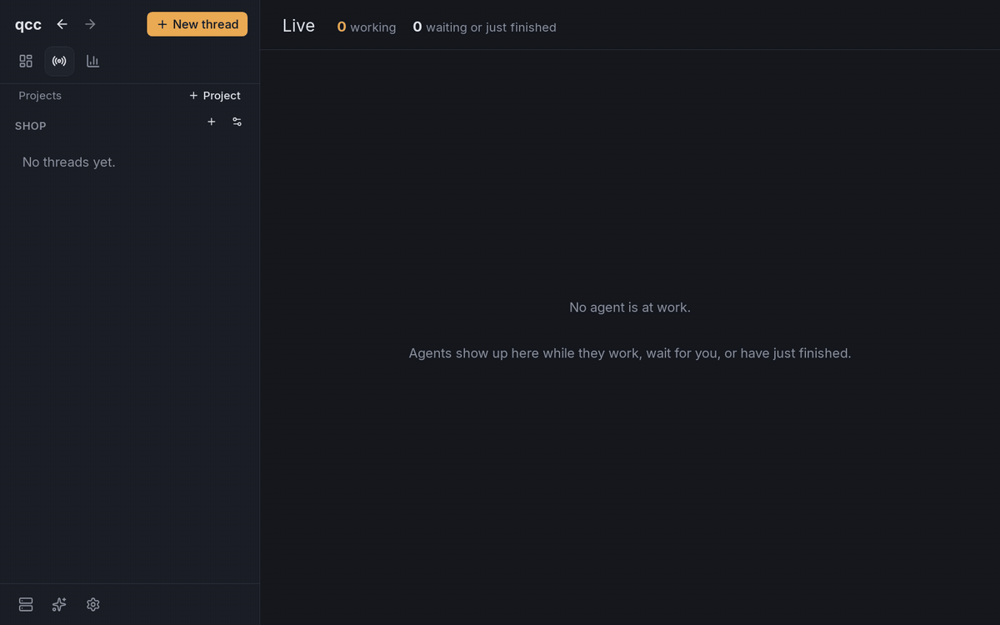
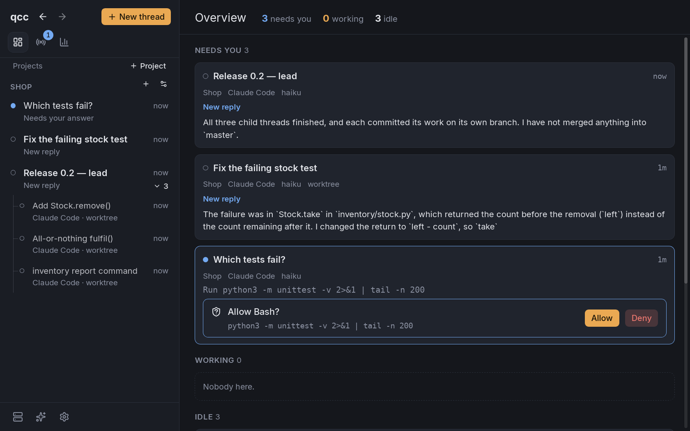
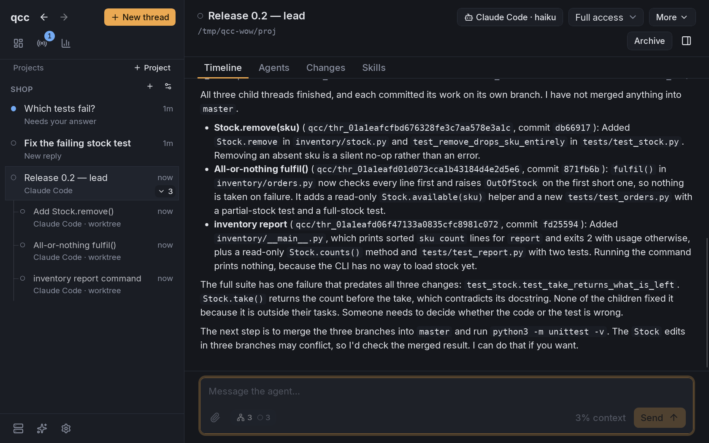
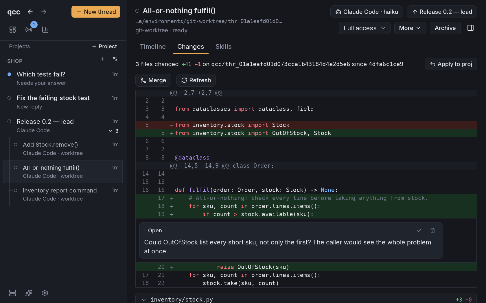
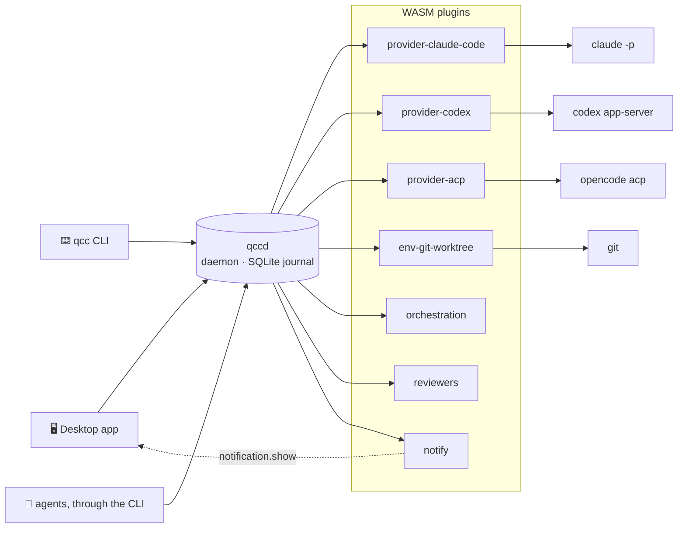

<p align="center">
  
</p>

<p align="center">
  
  
  
  
  
</p>

<p align="center">
  <b>Run Claude Code, Codex and opencode side by side.<br>
  Watch every agent in one place, answer whichever one needs you, and let agents delegate to agents.</b>
</p>

<p align="center">
  <a href="#features">Features</a> ·
  <a href="#a-closer-look">Screenshots</a> ·
  <a href="#getting-started">Getting started</a> ·
  <a href="docs/README.md">Documentation</a> ·
  <a href="README.ru.md">Русский</a>
</p>

<p align="center">
  
  <br>
  <sub><i>Real Claude Code sessions on the Live screen: a lead agent starts three children in their own worktrees, another one fixes a bug, a third waits for your permission.</i></sub>
</p>

---

qcc has no agent loop of its own. The real agent CLIs do the work; qcc runs their sessions as
**threads**, keeps every thread's timeline in a journal, isolates threads in git worktrees, lets
agents start other agents, and is extended with WebAssembly plugins.

## Features

<table>
  <tr>
    <td width="33%" valign="top">
      <h3>🧵 One timeline for every agent</h3>
      Claude Code, Codex and opencode speak different protocols. qcc turns each into the same
      timeline: messages, commands with output, edits with diffs, tool and MCP calls, permission
      prompts and questions.
    </td>
    <td width="33%" valign="top">
      <h3>🛰️ Many agents at once</h3>
      An overview of who needs you, who is working and who is done. A Live wall of running agents.
      Metrics of tokens, turns and tools over time.
    </td>
    <td width="33%" valign="top">
      <h3>✋ Answer from anywhere</h3>
      Approve a command or answer an agent's question from the thread, the overview card, the Live
      tile or the CLI.
    </td>
  </tr>
  <tr>
    <td valign="top">
      <h3>🌿 Isolated worktrees</h3>
      A thread can get its own git worktree on its own branch. Review the changes, comment on lines
      like in a code review, then apply or merge the work into your checkout.
    </td>
    <td valign="top">
      <h3>🪆 Agents start agents</h3>
      Agents delegate through the <code>qcc</code> CLI. Children inherit the parent's project,
      model and permission mode and never run with more freedom than the parent.
    </td>
    <td valign="top">
      <h3>🔀 Switch mid-thread</h3>
      Change the model, effort, permission mode or even the agent between turns; the new agent gets
      the conversation so far. Queue a message or steer it into the running turn. Fork a thread from
      any reply to try another way.
    </td>
  </tr>
  <tr>
    <td valign="top">
      <h3>🔍 Context you can see</h3>
      How full the context window is, what fills it (system prompt, tools, MCP, memory, skills),
      and compaction on request. How much of the Claude and Codex subscription limits is left,
      always in the sidebar.
    </td>
    <td valign="top">
      <h3>🧰 Shared setup</h3>
      MCP servers, skills and per-agent settings live in the daemon and reach every agent, on top
      of each agent's own configuration.
    </td>
    <td valign="top">
      <h3>🧩 Plugins all the way down</h3>
      Providers, worktrees and orchestration are ordinary <code>wasm32-wasip2</code> plugins with
      explicit permissions. Yours can add commands, skills, settings, screens and tabs.
    </td>
  </tr>
</table>

## A closer look

<table>
  <tr>
    <td width="50%" valign="top">
      
      <p align="center"><b>Overview</b><br><sub>Who needs you, who works, who is done. Answer a permission prompt right from the card.</sub></p>
    </td>
    <td width="50%" valign="top">
      
      <p align="center"><b>Orchestration</b><br><sub>A lead agent delegated three tasks, waited for them and reports back. Children sit under it.</sub></p>
    </td>
  </tr>
  <tr>
    <td width="50%" valign="top">
      
      <p align="center"><b>Timeline</b><br><sub>Commands, edits with highlighted diffs and the answer, with the Changes panel beside them.</sub></p>
    </td>
    <td width="50%" valign="top">
      
      <p align="center"><b>Review</b><br><sub>Comment on lines of a worktree's diff, send the comments to the agent, apply or merge.</sub></p>
    </td>
  </tr>
</table>

## How it fits together



- **`qccd`**, the daemon, holds the threads, the event journal and the plugin host. Agents keep
  working when the app is closed.
- **`qcc`**, the CLI, has `--json` on every command. Agents use the same CLI to start other agents
  and wait for them.
- **The desktop app** (Tauri + React) is a control panel over the same daemon.

The rule behind it: *the bridge knows the dialect, the core knows the timeline.* The core never
branches on which agent it talks to, and the built-in plugins use the same public API as yours.

## Getting started

qcc is developed on Linux. Everything builds inside a Nix flake, and `./dev` enters it by itself.

```sh
git clone https://github.com/quantk/qcc.git && cd qcc
./dev app        # build a release, install it to ~/.local/lib/qcc and open the app
```

Install the agents you want (`claude`, `codex`, `opencode`) and log in to them as usual. qcc finds
them in `PATH`, or you can point it at a binary in the settings.

The CLI of the installed build is `~/.local/lib/qcc/qcc`; put that directory on your `PATH` to call
it as `qcc`:

```sh
qcc thread spawn --provider claude-code --permission-mode ask --prompt 'what is in this directory?' --follow
qcc thread spawn --provider codex --env git-worktree --prompt 'add tests for the parser'
qcc thread list
qcc thread send <thread-id> 'and one more thing' --steer
qcc thread diff <thread-id>
qcc thread deliver <thread-id>     # apply the worktree's work to your checkout
```

No agent installed yet? `./dev demo` runs a few threads of the built-in `echo` test agent against a
temporary daemon.

| Agent       | Provider      | Through                  | Tested with         |
| ----------- | ------------- | ------------------------ | ------------------- |
| Claude Code | `claude-code` | `claude -p`, stream-json | Claude Code 2.1.325 |
| Codex       | `codex`       | `codex app-server`       | codex-cli 0.166.0   |
| opencode    | `opencode`    | `opencode acp`           | opencode 1.19.4     |

## Documentation

| | |
| --- | --- |
| 🤖 [Agents and sessions](docs/agents.md) | models, effort, switching agents, settings, MCP servers, permission modes, steering, compaction, forks, context, usage limits, attachments, skills |
| 🌿 [Projects and worktrees](docs/projects-and-worktrees.md) | projects, isolated worktrees, delivering work back, comments on changes |
| 🪆 [Orchestration](docs/orchestration.md) | agents starting agents, permission inheritance, `handoff` and `review` |
| 🔍 [Reviewers](docs/reviewers.md) | reviewers that look at a thread's changes when its agent is done: profiles, triggers, findings as line comments |
| ⏰ [Automations](docs/automations.md) | prompts sent to an agent on a schedule: cron or intervals, overlapping and missed runs, history |
| 🖥️ [Desktop app](docs/desktop.md) | screens, panels, shortcuts, layout |
| 🧩 [Writing a plugin](docs/plugins.md) | the plugin contract, UI, commands, skills, threads, permissions |
| 🛠️ [Development](docs/development.md) | dev commands, architecture, recorded agent traffic |

Contributing with a coding agent? [AGENTS.md](AGENTS.md) has the rules of the codebase.

## License

MIT.
