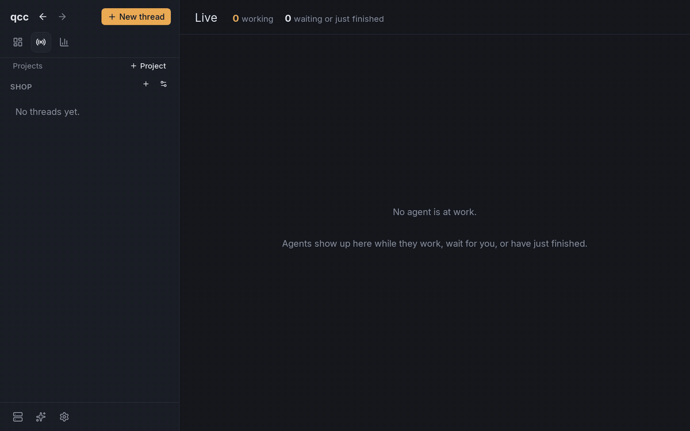
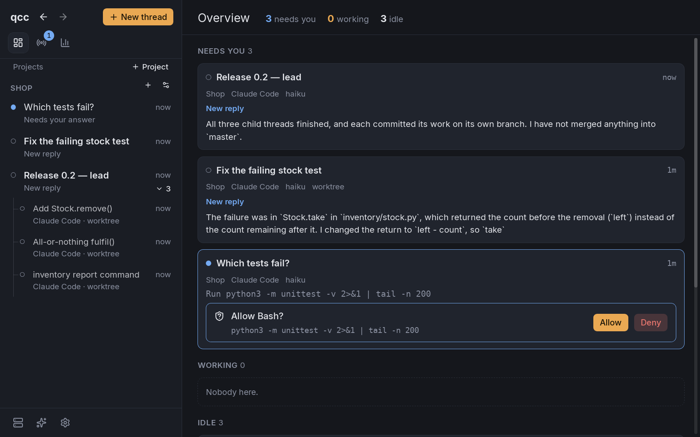
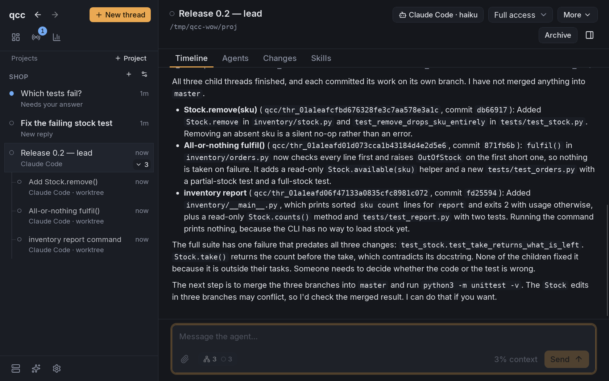
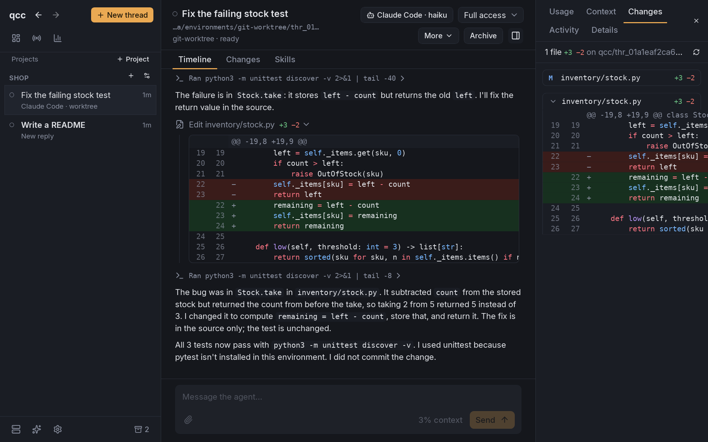
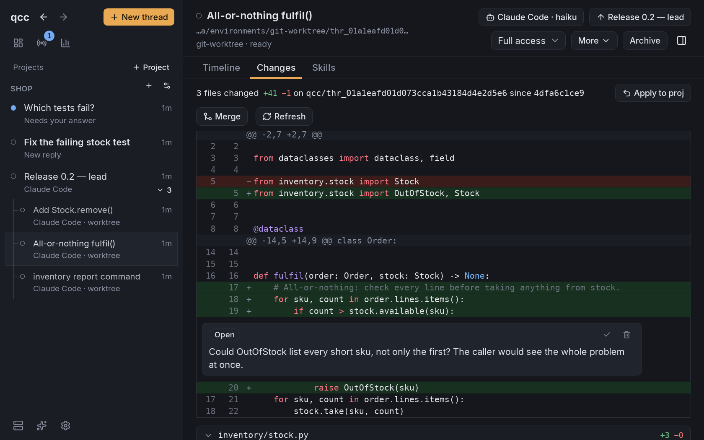
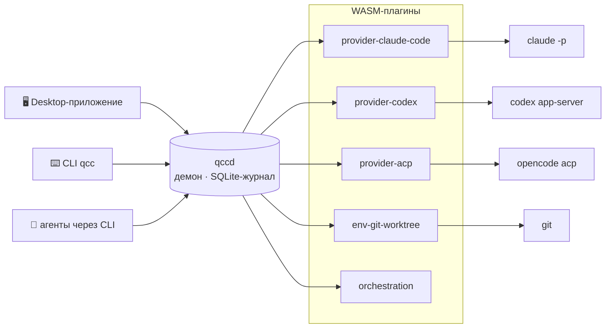

<p align="center">
  
</p>

<p align="center">
  
  
  
  
  
</p>

<p align="center">
  <b>Claude Code, Codex и opencode — параллельно.<br>
  Все агенты в одном месте: отвечайте тому, кому вы нужны, и пусть агенты поручают работу агентам.</b>
</p>

<p align="center">
  <a href="#возможности">Возможности</a> ·
  <a href="#поближе">Скриншоты</a> ·
  <a href="#начало-работы">Начало работы</a> ·
  <a href="docs/README.md">Документация</a> ·
  <a href="README.md">English</a>
</p>

<p align="center">
  
  <br>
  <sub><i>Настоящие сессии Claude Code на экране Live: лид запускает трёх потомков в их worktree, другой агент чинит баг, третий ждёт вашего разрешения.</i></sub>
</p>

---

Своего агентского цикла у qcc нет. Работают настоящие CLI агентов, а qcc ведёт их сессии как
**треды**: хранит ленту каждого треда в журнале, изолирует треды в git worktree, позволяет агентам
запускать других агентов и расширяется плагинами на WebAssembly.

## Возможности

<table>
  <tr>
    <td width="33%" valign="top">
      <h3>🧵 Одна лента для всех агентов</h3>
      У Claude Code, Codex и opencode разные протоколы. qcc переводит каждый в одну и ту же ленту:
      сообщения, команды с выводом, правки с диффами, вызовы инструментов и MCP, запросы разрешений
      и вопросы.
    </td>
    <td width="33%" valign="top">
      <h3>🛰️ Много агентов сразу</h3>
      Обзор: кто ждёт вас, кто работает, кто закончил. Стена Live с работающими агентами. Метрики
      токенов, ходов и инструментов во времени.
    </td>
    <td width="33%" valign="top">
      <h3>✋ Ответ откуда угодно</h3>
      Разрешить команду или ответить на вопрос агента можно в треде, на карточке обзора, на плитке
      Live или из CLI.
    </td>
  </tr>
  <tr>
    <td valign="top">
      <h3>🌿 Изолированные worktree</h3>
      Тред может получить собственный git worktree на своей ветке. Посмотрите изменения,
      прокомментируйте строки, как в код-ревью, и наложите или смёржите работу в свой checkout.
    </td>
    <td valign="top">
      <h3>🪆 Агенты запускают агентов</h3>
      Агенты делегируют через CLI <code>qcc</code>. Потомки наследуют проект, модель и режим
      разрешений родителя и никогда не работают свободнее него.
    </td>
    <td valign="top">
      <h3>🔀 Смена на ходу</h3>
      Между ходами можно сменить модель, effort, режим разрешений и даже агента; новый агент
      получает переписку. Сообщение можно поставить в очередь или подмешать в идущий ход.
    </td>
  </tr>
  <tr>
    <td valign="top">
      <h3>🔍 Видимый контекст</h3>
      Насколько заполнено контекстное окно, чем оно занято (системный промпт, инструменты, MCP,
      memory, skills), сжатие по запросу. Сколько осталось от лимитов подписок Claude и Codex —
      всегда на виду в сайдбаре.
    </td>
    <td valign="top">
      <h3>🧰 Общая настройка</h3>
      MCP-серверы, skills и настройки агентов хранит демон и передаёт каждому агенту в дополнение к
      его собственной конфигурации.
    </td>
    <td valign="top">
      <h3>🧩 Всё — плагины</h3>
      Провайдеры, worktree и оркестрация — обычные плагины <code>wasm32-wasip2</code> с явными
      правами. Ваш может добавить команды, skills, настройки, экраны и вкладки.
    </td>
  </tr>
</table>

## Поближе

<table>
  <tr>
    <td width="50%" valign="top">
      
      <p align="center"><b>Обзор</b><br><sub>Кто ждёт вас, кто работает, кто закончил. Ответить на запрос разрешения можно прямо с карточки.</sub></p>
    </td>
    <td width="50%" valign="top">
      
      <p align="center"><b>Оркестрация</b><br><sub>Лид раздал три задачи, дождался их и отчитывается. Потомки — под ним.</sub></p>
    </td>
  </tr>
  <tr>
    <td width="50%" valign="top">
      
      <p align="center"><b>Лента</b><br><sub>Команды, правки с подсвеченными диффами и ответ, рядом — панель Changes.</sub></p>
    </td>
    <td width="50%" valign="top">
      
      <p align="center"><b>Ревью</b><br><sub>Комментарии к строкам диффа worktree, отправка их агенту, наложение или merge.</sub></p>
    </td>
  </tr>
</table>

## Как это устроено



- **`qccd`** — демон: треды, журнал событий и хост плагинов. Агенты продолжают работать, когда
  приложение закрыто.
- **`qcc`** — CLI, у каждой команды есть `--json`. Через тот же CLI агенты запускают других агентов
  и ждут их.
- **Desktop-приложение** (Tauri + React) — пульт поверх того же демона.

Главное правило: *мост знает диалект, ядро знает ленту.* Ядро никогда не ветвится по тому, с каким
агентом говорит, а встроенные плагины пользуются тем же публичным API, что и ваши.

## Начало работы

qcc разрабатывается на Linux. Всё собирается внутри Nix flake, и `./dev` заходит в него сам.

```sh
git clone https://github.com/quantk/qcc.git && cd qcc
./dev app        # собрать release, поставить в ~/.local/lib/qcc и открыть приложение
```

Установите нужных агентов (`claude`, `codex`, `opencode`) и войдите в них как обычно: qcc найдёт
их в `PATH`, а в настройках можно указать конкретный файл.

CLI установленной сборки — `~/.local/lib/qcc/qcc`; добавьте этот каталог в `PATH`, чтобы звать его
как `qcc`:

```sh
qcc thread spawn --provider claude-code --permission-mode ask --prompt 'что в этом каталоге?' --follow
qcc thread spawn --provider codex --env git-worktree --prompt 'добавь тесты для парсера'
qcc thread list
qcc thread send <thread-id> 'и ещё вот что' --steer
qcc thread diff <thread-id>
qcc thread deliver <thread-id>     # наложить работу из worktree на свой checkout
```

Агентов ещё нет? `./dev demo` прогоняет несколько тредов встроенного тестового агента `echo` на
временном демоне.

| Агент       | Провайдер     | Через                    | Проверено на версии |
| ----------- | ------------- | ------------------------ | ------------------- |
| Claude Code | `claude-code` | `claude -p`, stream-json | Claude Code 2.1.325 |
| Codex       | `codex`       | `codex app-server`       | codex-cli 0.166.0   |
| opencode    | `opencode`    | `opencode acp`           | opencode 1.19.4     |

## Документация

Подробная документация — на английском:

| | |
| --- | --- |
| 🤖 [Agents and sessions](docs/agents.md) | модели, effort, смена агента, настройки, MCP-серверы, режимы разрешений, steer, сжатие, контекст, лимиты подписок, вложения, skills |
| 🌿 [Projects and worktrees](docs/projects-and-worktrees.md) | проекты, изолированные worktree, возврат работы, комментарии к изменениям |
| 🪆 [Orchestration](docs/orchestration.md) | агенты запускают агентов, наследование режима, `handoff` и `review` |
| ⏰ [Automations](docs/automations.md) | промпты агенту по расписанию: cron или интервалы, наложение и пропуск запусков, история |
| 🖥️ [Desktop app](docs/desktop.md) | экраны, панели, горячие клавиши, раскладка |
| 🧩 [Writing a plugin](docs/plugins.md) | контракт плагинов, UI, команды, skills, треды, права |
| 🛠️ [Development](docs/development.md) | команды разработки, устройство, записанный трафик агентов |

Работаете с репозиторием через кодового агента? Правила кодовой базы — в [AGENTS.md](AGENTS.md).

## Лицензия

MIT.
